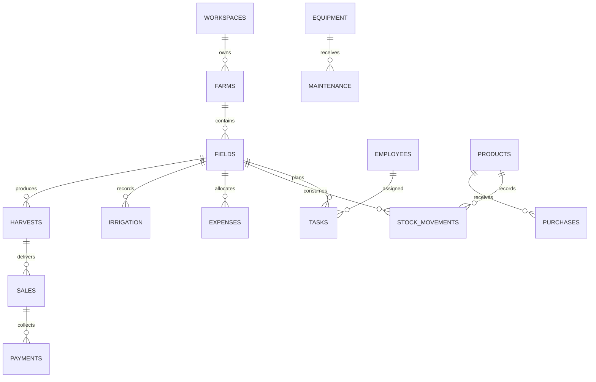

# Architecture and data integrity

## Runtime

React 19 and TypeScript use Next.js-compatible routing through Vinext on Cloudflare Workers. Sites provides private hosting and ChatGPT sign-in. Cloudflare D1 supplies a durable relational SQLite database. The portable edition replaces this adapter with PostgreSQL/PostGIS; the hosted edition retains D1. Redis, paid AI and microservices are intentionally omitted.

## Boundaries

`app/agrios.tsx` renders the interface and calls `api/state`, `api/action` and `api/weather`. `lib/domain.mjs` contains deterministic money, quantity, KPI and rule calculations. `lib/server.ts` owns scoped reads, validation and atomic mutations. `db/schema.ts` and immutable Drizzle migrations own the schema. `lib/seed.ts` creates reproducible fictional demonstration data after a workspace is initialized.

## ERD

Every table is scoped by `owner`. Relationships between scoped domain records use composite foreign keys. Identifiers supplied by the browser are checked against the authenticated owner before writes. No database credentials are exposed to the browser. The hosted dispatch authentication boundary owns trusted identity headers. Anonymous visitors receive a nonpersistent read-only seeded snapshot, and anonymous writes are rejected.

## Money and quantity

Monetary records use integer cents; quantity uses integer thousandths of the stated unit. Inputs reject scientific notation, nonfinite values and excess precision. Line totals round once to cents. Inventory valuation uses standard product cost, not FIFO or statutory inventory accounting. Seeded opening stock and historical opening costs are independent opening balances. Procurement cash, field input consumption and sales revenue have separate meanings. A purchase receipt is not added to field operating costs until consumption, preventing duplicate counting. Standard-cost variances are not posted to a general ledger.

## Atomic workflows

- Receipt: purchase plus positive stock movement plus audit record.
- Consumption: conditional negative movement only if recorded balance is sufficient; matched field expense and audit require that movement to exist.
- Labor: task completion plus one unique task-linked labor expense.
- Water: event plus matched field expense.
- Maintenance: maintenance record, next service date and overhead expense.
- Sale: conditional invoice only when batch quantity minus prior delivered sales is sufficient.
- Payment: guarded payment event, paid balance update and audit. A payment cannot exceed remaining invoice balance.

D1 `batch()` gives ordered transaction semantics. Request keys and domain-reference unique indexes prevent duplicate posting on retries. Queries never derive authority from submitted owner IDs. Schema checks, foreign keys and owner filters are tested independently.

## Definitions

Revenue = sum of delivered sale line totals. Operating cost = sum of allocated expense rows. Management contribution = revenue minus operating cost. This excludes taxes, depreciation, unrecorded overhead and statutory adjustments. Receivables = invoice totals less recorded paid amounts. Harvest availability = registered batch quantity less delivered sale quantity. No charts have independent hardcoded KPI totals.

## Deployment and recovery

Build with `node /path/to/sites/scripts/build-site.mjs` or the documented starter build command. Local schema migrations apply using Wrangler with `dist/server/wrangler.json` and `.wrangler/state`. Hosted Sites publication applies migrations. Export workspace JSON for an owner-held data copy. Automated disaster recovery and restore drills have not been verified; configure provider backups and a tested restore procedure before production.

## Integrations

Weather calls Open-Meteo for the company office reference in Bazioun, Jbeil. This is not a surveyed growing-plot coordinate. Returned source and timestamp are visible; an unavailable provider produces a labelled sample forecast. MapLibre displays the office pin on an attributed OpenStreetMap basemap, while the separate SVG field layout remains a fictional schematic. No field device or physical actuator is connected. The specific Figma design is pending.

## Portable Next.js / PostgreSQL edition

`portable/` contains the local runtime templates. `node scripts/package-portable.mjs` creates a self-contained Next.js application in `outputs/Daccache-Farms-AgriOS` using the same UI, domain functions and action logic. It replaces the hosted D1 binding with a parameterized `pg` adapter and hosted identity with a local owner session. It never accepts ChatGPT identity headers as local authentication.

The PostgreSQL migration creates relational tables and unique indexes before adding composite foreign keys. Transactions use SERIALIZABLE isolation with bounded retry of SQLSTATE 40001. The local owner password is scrypt-hashed; cookies have HMAC signatures, expiry, HttpOnly and SameSite=Strict. Database-backed rate limiting covers local sign-in. Docker exposes PostgreSQL only on loopback; Next.js also binds to loopback by default.

PostGIS stores separate SRID 4326 Polygon geometries. Geometry parsing, validity, nonempty checks, scoped references, a GiST spatial index and ST_Area(geography) calculations are implemented. Operational hectares and schematic coordinates remain separate from user-supplied boundaries. The MapLibre company marker represents the published office reference only.

The hosted and portable databases are separate installations. Publishing the hosted edition does not provide a managed PostgreSQL service and does not synchronize local records. No automatic JSON restore or data migration between the editions is claimed.
